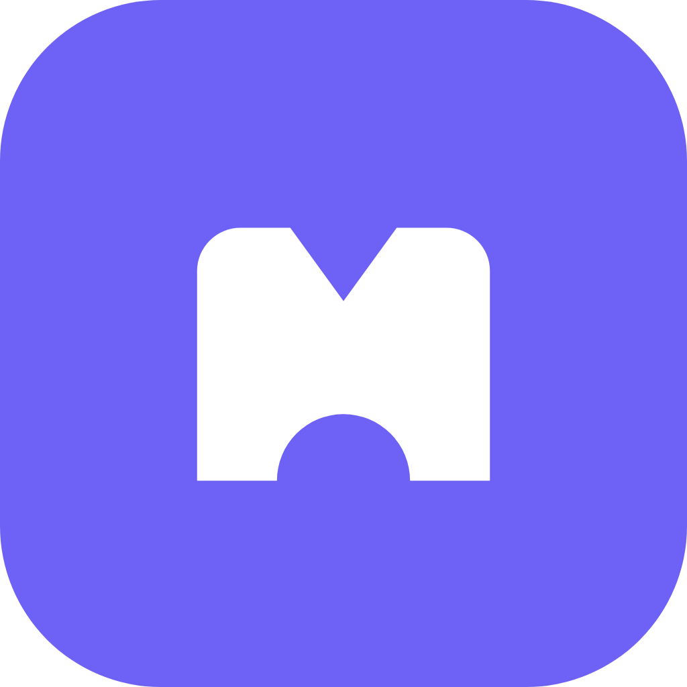

<p align="center">
  
</p>

<h1 align="center">Model Bridge</h1>

<p align="center">
  Use your ChatGPT and Claude subscriptions as a local, OpenAI-compatible API on Windows.
</p>

<p align="center">
  
  
  
</p>

---

Model Bridge is a small desktop app that runs an OpenAI-compatible endpoint on `127.0.0.1`. Requests are answered
through the official **Codex** (ChatGPT) and **Claude Code** CLIs, using the sign-ins those CLIs already store. Point
any tool that speaks the OpenAI API (editors, chat front-ends, scripts) at it and pick a model.

## Features

- **Connect accounts** – sign in to ChatGPT or Claude through the official CLIs; missing CLIs install with one click (winget).
- **Model catalog** – every model your plans expose, with provider icons, search and a one-click access test.
- **Named API keys** – one key per client. Show, copy or revoke any key later. Keys are encrypted with Windows DPAPI for your user account; requests are checked against SHA-256 fingerprints.
- **Local only** – the server listens on `127.0.0.1` (port 8765, or a free port if it is taken).
- **First-run tour** – a short walkthrough on first launch, available any time from *Getting started*.

## Install

Download `ModelBridge.exe` from [Releases](../../releases) and run it. No installer or admin rights needed.

You also need at least one of these CLIs (Model Bridge can install them for you):

| Provider | CLI | winget id |
|---|---|---|
| ChatGPT | Codex | `OpenAI.Codex` |
| Claude | Claude Code | `Anthropic.ClaudeCode` |

## Quick start

1. **Overview → Connect** ChatGPT or Claude and finish the sign-in window.
2. **API keys → Create key**, name it after your client (for example *Cursor*).
3. **Overview → Start local API**, then **Copy URL** (for example `http://127.0.0.1:8765/v1`).
4. **Models** – select a model, **Test model**, then **Copy model ID**.
5. In your client choose an *OpenAI-compatible* provider and paste the base URL, key and model ID.

```bash
curl http://127.0.0.1:8765/v1/chat/completions \
  -H "Authorization: Bearer mb_your_key" \
  -H "Content-Type: application/json" \
  -d '{"model": "claude/default", "messages": [{"role": "user", "content": "Hello"}]}'
```

### Supported endpoints

| Method | Path | Notes |
|---|---|---|
| `GET` | `/v1/models` | Models reported by the connected CLIs |
| `POST` | `/v1/chat/completions` | Single, non-streaming text responses |

The CLI catalog can list models your plan cannot run. Availability and rate limits are set by each provider, and
your use must follow their terms.

## Build from source

```bash
git clone https://github.com/pratyush-kiran/ModelBridge.git
```

```bash
python desktop.py
```

```bash
pip install pyinstaller
```

```powershell
./build.ps1   # produces dist/ModelBridge.exe
```

Requires Python 3.12 with Tk. `bridge.py` keeps the original console entry point.

## Project layout

| Path | Purpose |
|---|---|
| `desktop.py` | Tkinter desktop app (UI, tour, server control) |
| `bridge.py` | OpenAI-compatible HTTP server and CLI calls |
| `providers.py` | Discovers CLIs, accounts and models |
| `keys.py` | Encrypted local API key store |
| `assets/` | Logo, icon and UI icons (`assets/brand` has the SVG masters and icon generator) |

## Contributing

Issues and pull requests are welcome. Please keep changes small and describe how you tested them on Windows.

## Disclaimer

Model Bridge is an independent project and is not affiliated with or endorsed by OpenAI or Anthropic. ChatGPT,
Codex, Claude and Claude Code are trademarks of their respective owners.

## License

[MIT](LICENSE)
